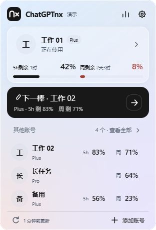
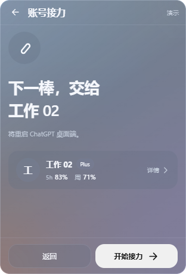
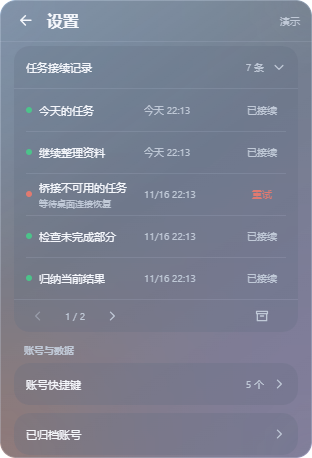
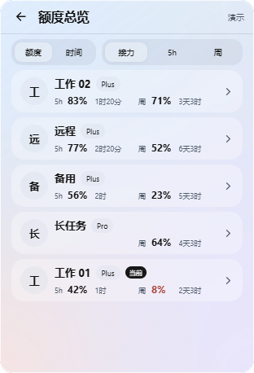
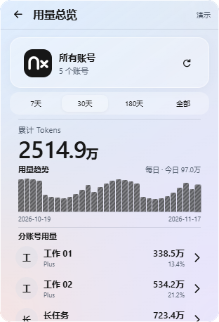
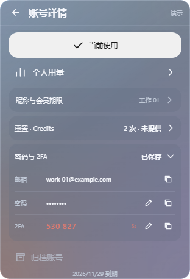
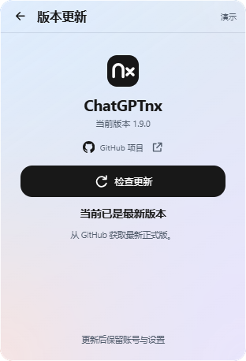

[简体中文](README.md) · **English**

  
  <h1>ChatGPTnx</h1>
  
Manage ChatGPT accounts, quotas, and local task continuation from the Windows tray.

  
<a href="https://github.com/LUMIAO9527/ChatGPTnx/releases/latest/download/ChatGPTnx.exe"><b>Download ChatGPTnx.exe</b></a> · <a href="https://github.com/LUMIAO9527/ChatGPTnx/releases/latest">Release notes and offline demo</a> · <a href="USAGE.md">User guide (Chinese)</a>

  
 

  
  

## Getting started

Requires 64-bit Windows 10 or 11, the ChatGPT desktop app with a signed-in account, Microsoft .NET Framework 4.6.2 or later, and Microsoft Edge WebView2 Runtime.

1. Launch `ChatGPTnx.exe` and choose a program folder. Open NX from the Windows tray after setup.
2. Select **Add account** and sign in through ChatGPT.
3. Select **Next account** to switch. Enable automatic handoff and task continuation in Settings.
4. Install updates from **Settings → About → Version update**.

## Screenshots

The app and demo use a Chinese interface.

| Confirm a handoff | Review continuation | Compare quotas |
| :---: | :---: | :---: |
|  |  |  |

| Review usage | Manage passwords and 2FA | Check for updates |
| :---: | :---: | :---: |
|  |  |  |

## Data and source

To move to another computer, export a password-protected backup from **Settings → Accounts and data → Import and export**.

Download the source package, run `setup.cmd` to install dependencies, then run `build.cmd`. [Releases](https://github.com/LUMIAO9527/ChatGPTnx/releases/latest) · [Changelog](CHANGELOG.md) · [License](LICENSE)
