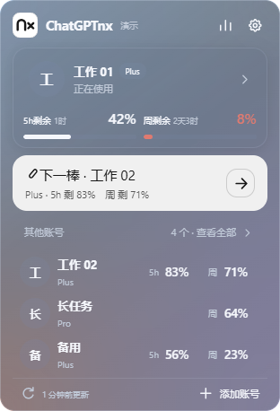

[简体中文](README.md) · **English**

  
  <h1>ChatGPTnx</h1>
  
Manage ChatGPT accounts, quotas, and local task continuation from the Windows tray.

  
<a href="https://github.com/LUMIAO9527/ChatGPTnx/releases/latest/download/ChatGPTnx.exe"><b>Download ChatGPTnx.exe</b></a> · <a href="https://github.com/LUMIAO9527/ChatGPTnx/releases/latest">Release notes and offline demo</a> · <a href="USAGE.md">User guide (Chinese)</a>

  
 

  
  

## Getting started

Requires 64-bit Windows 10 or 11, the ChatGPT desktop app with a signed-in account, Microsoft .NET Framework 4.6.2 or later, and Microsoft Edge WebView2 Runtime.

1. Launch `ChatGPTnx.exe` and choose a program folder. Open NX from the Windows tray after setup.
2. Select **Add account** and sign in through ChatGPT. NX verifies and saves the account.
3. Try a manual handoff with **Next account**. In Settings, choose the accounts to use and enable automatic handoff or task continuation as needed.
4. To update an existing installation, open **Settings → About → Version update**.

For work you want to continue on the same computer after switching accounts, start the task locally in a local project. NX tries the desktop app's native **Continue** action first and records the outcome. Private cloud chats appear under the ChatGPT account that owns them.

## Screenshots

The screenshots use synthetic accounts and data. The [latest release](https://github.com/LUMIAO9527/ChatGPTnx/releases/latest) includes an offline HTML demo with the current screens, both themes, and interactive examples. The UI is in Chinese.

| Confirm a handoff | Review continuation | Compare quotas |
| :---: | :---: | :---: |
|  |  |  |

| Review usage | Manage passwords and 2FA | Check for updates |
| :---: | :---: | :---: |
|  |  |  |

- **Handoff** supports manual, automatic, and scheduled switching after quota recovery. Optional preheat is available for spare accounts.
- **Accounts and usage** include quota comparisons, token usage by account, aliases, membership dates, and archiving.
- **Passwords and 2FA** can be updated from account details, with support for replacing a saved authenticator and importing Google Authenticator QR codes.
- **Appearance and controls** include light and dark themes, frosted glass and solid surfaces, tray notifications, and keyboard shortcuts.

## Data and source

Account snapshots and saved sign-in details use Windows current-user encryption. To move to another computer, export a password-protected backup from **Settings → Accounts and data → Import and export**. The diagnostic summary in Settings can be previewed and copied with sensitive fields removed.

Download the source package from the [latest release](https://github.com/LUMIAO9527/ChatGPTnx/releases/latest). Run `setup.cmd` to prepare the dependencies and `build.cmd` to build the app. See the [user guide](USAGE.md) and [changelog](CHANGELOG.md) for details.

The source is available to inspect. See the [LICENSE](LICENSE) for use and distribution terms. ChatGPTnx is an independent tool and is not affiliated with OpenAI.
