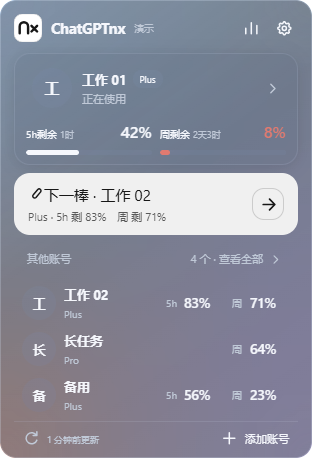
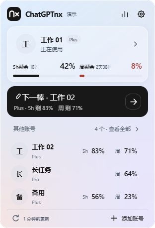
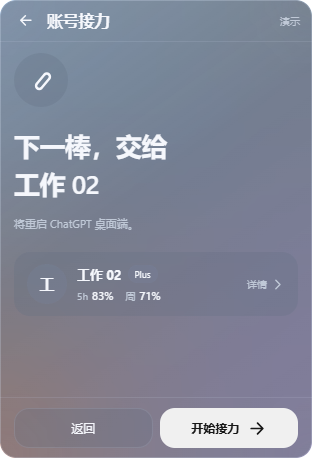
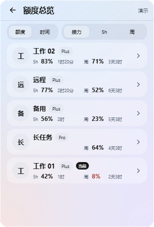
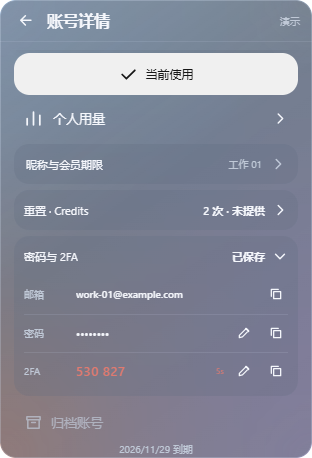
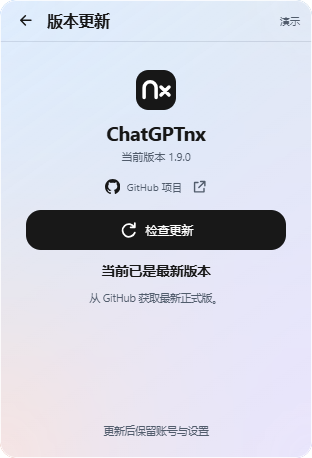

**简体中文** · [English](README.en.md)

  
  <h1>ChatGPTnx</h1>
  
从 Windows 托盘管理 ChatGPT 账号、额度和本机任务接续。

  
<a href="https://github.com/LUMIAO9527/ChatGPTnx/releases/latest/download/ChatGPTnx.exe"><b>下载 ChatGPTnx.exe</b></a> · <a href="https://github.com/LUMIAO9527/ChatGPTnx/releases/latest">版本说明与离线演示</a> · <a href="USAGE.md">使用说明</a>

  
 

  
  

## 开始使用

需要 Windows 10 或 11（64 位）、已登录的 ChatGPT 桌面应用、Microsoft .NET Framework 4.6.2 或更新版本，以及 Microsoft Edge WebView2 Runtime。

1. 启动 `ChatGPTnx.exe`，选择程序文件夹。以后可从 Windows 托盘打开 NX。
2. 点击「添加账号」，在 ChatGPT 完成登录。
3. 点击首页的「下一棒」切换账号。自动接力和任务接续可在设置中开启。
4. 从「设置 → 关于 → 版本更新」安装新版。

## 界面速览

| 确认账号接力 | 查阅接续记录 | 比较账号额度 |
| :---: | :---: | :---: |
|  |  |  |

| 查看用量趋势 | 管理密码与 2FA | 检查版本更新 |
| :---: | :---: | :---: |
|  |  |  |

## 数据与源码

「设置 → 账号与数据 → 导入与导出」可生成带密码的备份，供迁移到另一台电脑。

下载源码包后，运行 `setup.cmd` 安装依赖，再运行 `build.cmd` 构建。 [发布页](https://github.com/LUMIAO9527/ChatGPTnx/releases/latest) · [更新记录](CHANGELOG.md) · [许可](LICENSE)
