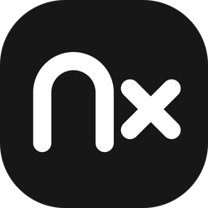
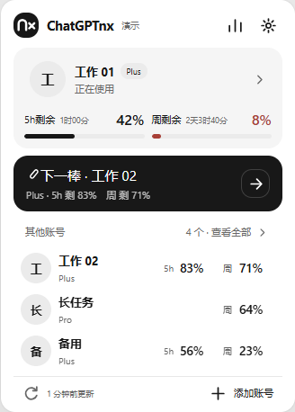
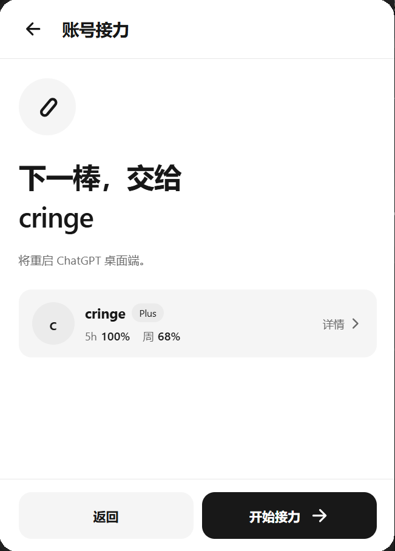
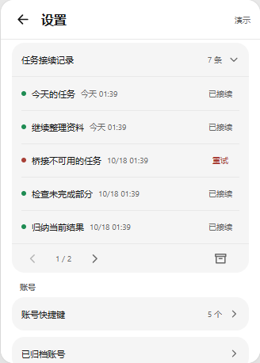
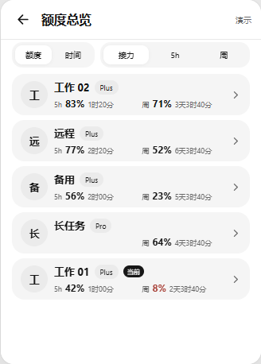
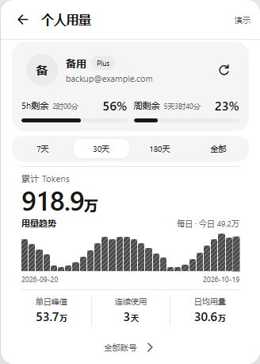
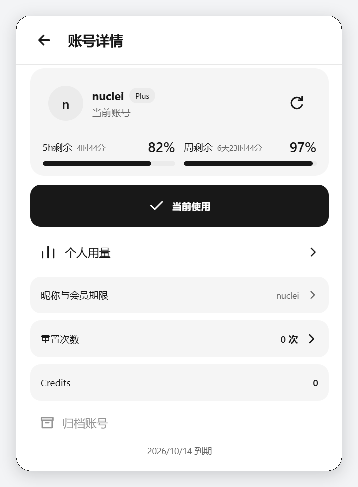
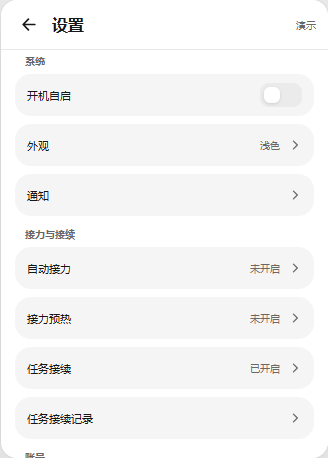
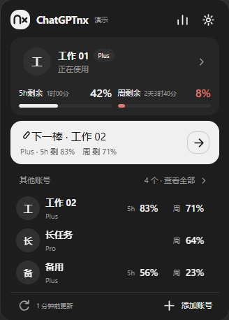
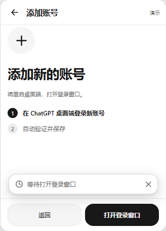

**简体中文** | [English](README.en.md)

<h1>ChatGPTnx</h1>

<b>自动接力 · 任务接续 · 按用量配置 n×</b>

用 n 个 Plus 账号，接力推进一个长任务。自动切号，继续原任务。

ChatGPTnx 是一款轻量的 Windows 桌面工具，通过多账号自动接力与任务接续，减少长任务因额度耗尽而中断后的等待和手动操作。

## 视频介绍

https://github.com/user-attachments/assets/e1d24f80-0716-4bba-a024-7058e5c0b2e0

## 功能

- **自动接力**：额度耗尽时切换到有可用额度的参与账号，支持手动接力、自定义参与账号，以及可取消的“恢复后接力”预约。
- **接力预热**：工作期间，用极短请求提前启动所选备用 Plus 的 5h 计时；额度恢复后继续准备下一轮。默认关闭，不切换桌面登录，同一窗口不重复发送。
- **任务接续**：切换账号后接续原桌面任务，支持自定义接续消息，分别查看成功、跳过和需查看的记录；识别到的后台子任务不单独触发桌面接续。
- **额度与用量**：集中查看各账号的剩余额度、重置时间和 Token 用量；短暂查询失败保留已知额度，各页面与接力判断一致。普通查询与预热共用暂停和冷却规则。
- **凭据保护与诊断**：使用 Windows 当前用户加密保护账号快照，提供可预览、可复制的脱敏诊断摘要。
- **资料迁移**：在设置中加密导出所选账号、昵称与会员资料，并可附带用量、额度记录和通用设置；在另一台电脑导入备份后继续使用。
- **安装与卸载**：登记到 Windows“已安装的应用”，从系统或设置进入同一个卸载页，可选择保留账号与数据。
- **登录与更新**：登录期间面板默认保持可见，检测到完整登录后自动验证并保存；自动检查 GitHub 正式更新并通知，点击后进入更新页下载和安装。
- **密码与 2FA**：在账号详情中加密保存登录资料，支持导入手机 Google Authenticator 二维码、显示实时验证码，以及在明确的登录页逐步填入邮箱、密码和验证器验证码。
- **轻量化**：常驻 Windows 托盘，面板用完即收起，支持通知、快捷键、深浅外观及可切换的磨砂玻璃与纯色材质。

### 持续任务能力

ChatGPTnx 的核心，是让多个 Plus 账号接力推进同一个长任务。当前账号额度耗尽时，**自动接力**切换到下一个可用账号，**任务接续**随后继续原桌面任务，减少手动切号和重新接续的操作。

**n× 代表可以按实际用量自由配置的账号数量。** 你可以从少量账号开始，根据任务强度和使用频率增加账号，或调整参与接力的账号。例如，配置 5 个 Plus 账号，就可以让它们轮流参与接力，让长任务更少因单个账号的额度限制而停下来等待。

自动接力和任务接续共同提供持续任务能力；额度总览、用量统计与轻量桌面操作为它们提供配套支持，让你看清可用额度、判断实际用量，并更方便地安排下一棒。

## 界面

### 账号接力与任务接续

| 首页 · 当前账号与下一棒 | 账号接力 · 确认下一棒 | 任务接续 · 查看记录 |
| --- | --- | --- |
|  |  |  |

### 额度与用量

| 额度总览 | 个人用量 | 账号详情 |
| --- | --- | --- |
|  |  |  |

### 设置与外观

| 设置 | 深色外观 | 添加账号 |
| --- | --- | --- |
|  |  |  |

## 下载与运行

当前版本为 **v1.8.4**。完整页面与状态可用根目录的 `ChatGPTnx-v1.8.4.html` 离线查看。

切号后优先触发原对话的“继续”按钮。确认按钮操作未发出时，程序会发送已配置的接续消息。

可从 [v1.8.4 Release](https://github.com/LUMIAO9527/ChatGPTnx/releases/tag/v1.8.4) 下载 `ChatGPTnx.exe`、源码 `ChatGPTnx-v1.8.4-source.zip` 和完整演示 `ChatGPTnx-v1.8.4.html`。需要 Windows 10 / 11 64 位、已安装并登录的 ChatGPT 桌面应用、Microsoft .NET Framework 4.6.2 或更高版本，以及 Microsoft Edge WebView2 Runtime。

1. 首次启动会直接打开面板选择程序文件夹（推荐 `D:\ChatGPTnx`，选择前不会在原位置写入文件），之后从托盘打开面板。
2. 点击“添加账号”，在 ChatGPT 完成登录；程序自动验证并保存。验证暂未完成时，可在面板点击“重试验证”。
3. 先用“下一棒”完成一次手动接力，再在设置中开启自动接力并选择参与账号。
4. 开启“切号后自动接续任务”，根据需要配置接续消息；在任务接续记录中查看结果。
5. 迁移资料时，在“设置 → 账号与数据 → 导入与导出”保存加密备份，再在另一台电脑导入。

关闭面板只是收起界面，程序仍在托盘运行；需要完全退出时，使用托盘菜单。

## 演示与调试

双击根目录的 [ChatGPTnx-v1.8.4.html](ChatGPTnx-v1.8.4.html)，或运行 `preview.cmd`。一个文件覆盖全部页面和关键状态，支持搜索、浅深色、模拟登录、更新状态以及调试报告导出。演示默认按可用空间放大并居中，也可切换到 100% 真实尺寸检查。所有数据均为合成数据，不访问本机账号，也不执行真实切号、下载或安装。

演示台提供全部界面检查与转场中间帧检查，方便复查布局变化、快速返回、原地展开、浮动提示、数据刷新和长更新说明。正式面板以统一规则衔接信息卡片、主按钮或头像；没有公共内容时采用正文整体过渡。

维护时运行 `python tools/build.py` 和 `python tools/build_explorer.py`；`build.cmd` 也会同步生成总 HTML。构建玻璃宿主需要 Windows 10 / 11 SDK，发布程序已内置该组件。它直接嵌入正式 UI 组件，后续修改无需另写预览页面。Windows 原生窗口行为仍需在本机验证。

组件尺寸、展开与分页、状态提示和流程规则见[面板与状态设计](docs/DESIGN.md)。

## 密码与 2FA

在“设置 → 账号与数据 → 账号库”添加登录资料，也可按一行一个账号批量导入 `邮箱----密码----2FA 资料----兑换链接`。兑换码和兑换链接会分别保留；已知密钥或标准验证器链接可由 NX 在本机计算验证码。

手机已有 Google Authenticator 时，进入“账号库 → 导入 2FA”，选择同一批导出的全部二维码图片，核对每条验证器对应的邮箱后导入。手机和 NX 随后可同时生成验证码。账号详情的“密码与 2FA”提供邮箱、密码和验证码的查看、复制入口，密码显示三秒后自动隐藏。

需要更换验证器时，先登录对应账号，在 ChatGPT 的安全设置中取得新密钥，再从账号详情进入“更换验证器”。把 NX 计算的验证码填入 ChatGPT，完成服务端确认后勾选确认项，保存新密钥和恢复码。完整操作见 [使用说明](USAGE.md)。

从账号库选择“登录”或“重登”后，NX 在已识别的登录页面逐步填入。手机号、邮箱验证码、人机验证和无法识别的页面会交给用户完成，正常登录检测继续运行。

## 数据与隐私

账号快照、归档快照和事务恢复备份使用 Windows 当前用户保护加密，并限制文件权限。跨电脑迁移使用程序的密码加密备份，导入时会按新电脑的 Windows 用户重新保护凭据。官方桌面应用的活动认证文件保留原有格式。

账号与运行数据保存在程序所在目录，请妥善保管，勿公开上传。反馈问题时优先使用设置中的“诊断摘要”；摘要不包含邮箱、令牌、任务正文和本机路径，也不会自动上传。

查询恢复、任务接续边界和旧程序回退流程见 [使用说明](USAGE.md)。回退到不支持加密快照的程序前，必须先按说明恢复凭据格式。

## 授权

源码可下载查看，使用与授权条款见 [LICENSE](LICENSE)。本项目与 OpenAI 没有隶属或认可关系。
